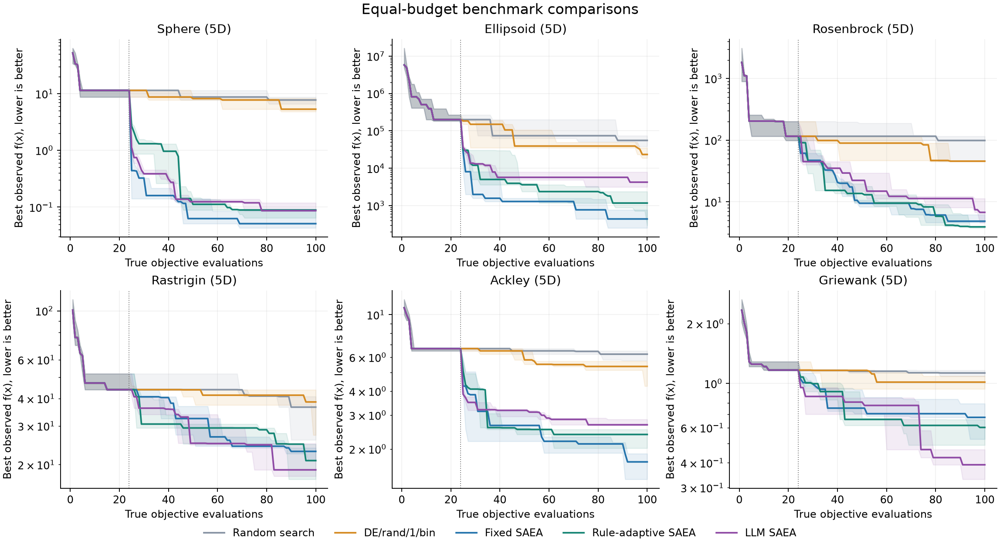
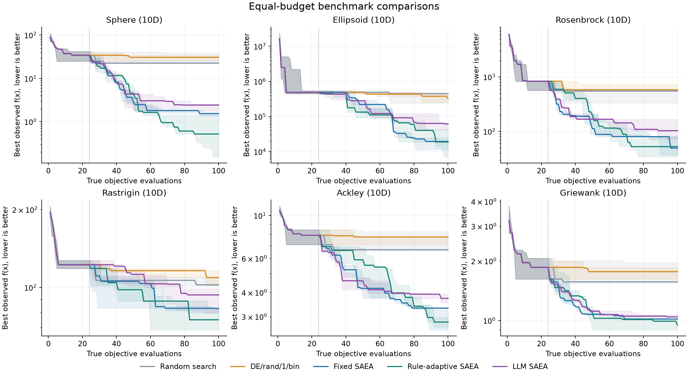

# 实验结果与可复现性报告

2026-10-23；最终提交版

## 实验协议

6 个函数 × 2 个维度（5D、10D）× 5 个种子（0-4）× 5 个方法，共 300 次独立优化运行、30000 次真实目标评价。其中 240 次既有离线对照逐字节保留，新增 60 次在线 DeepSeek 动态优化。每次预算 100，初始 LHS 为 24 点；同一函数/维度/种子下，各方法共享初始样本。没有依据在线结果修改参数或删除不利运行。

## 核心结果

在线 LLM 在 2/12 个实例上的最终中位数优于固定 SAEA，在 3/12 个实例上优于规则 SAEA。五方法平均名次为 random=4.50；de=4.50；saea=1.83；adaptive=1.58；llm=2.58。在线 LLM 对两个 SAEA 对照的 Holm 校正显著项分别为 0 和 0。这是一组小样本基准证据，不支持声称 LLM 对任意问题普遍更优。

## 5D 最终目标

| 函数 | Random | DE | 固定 SAEA | 规则 SAEA | LLM SAEA |
|---|---:|---:|---:|---:|---:|
| sphere | 8.232e+00 ± 2.68e+00 | 5.673e+00 ± 3.00e+00 | 6.454e-02 ± 2.84e-02 | 7.477e-02 ± 3.68e-02 | 1.046e-01 ± 3.72e-02 |
| ellipsoid | 7.599e+04 ± 5.82e+04 | 2.765e+04 ± 1.57e+04 | 6.041e+02 ± 5.15e+02 | 1.551e+03 ± 1.44e+03 | 5.147e+03 ± 2.69e+03 |
| rosenbrock | 9.877e+01 ± 5.94e+01 | 5.140e+01 ± 2.25e+01 | 6.108e+00 ± 3.50e+00 | 4.192e+00 ± 9.98e-01 | 7.773e+00 ± 4.24e+00 |
| rastrigin | 3.454e+01 ± 8.41e+00 | 3.499e+01 ± 1.01e+01 | 2.103e+01 ± 4.45e+00 | 1.953e+01 ± 6.20e+00 | 1.957e+01 ± 6.48e+00 |
| ackley | 6.041e+00 ± 7.89e-01 | 5.185e+00 ± 1.01e+00 | 1.676e+00 ± 3.81e-01 | 2.232e+00 ± 3.64e-01 | 2.676e+00 ± 3.01e-01 |
| griewank | 9.733e-01 ± 3.69e-01 | 9.754e-01 ± 1.73e-01 | 6.464e-01 ± 1.81e-01 | 5.757e-01 ± 9.21e-02 | 4.086e-01 ± 8.64e-02 |

## 10D 最终目标

| 函数 | Random | DE | 固定 SAEA | 规则 SAEA | LLM SAEA |
|---|---:|---:|---:|---:|---:|
| sphere | 2.808e+01 ± 1.07e+01 | 2.957e+01 ± 6.08e+00 | 1.518e+00 ± 2.26e-01 | 7.674e-01 ± 7.06e-01 | 2.188e+00 ± 1.01e+00 |
| ellipsoid | 3.794e+05 ± 1.57e+05 | 3.024e+05 ± 1.35e+05 | 2.012e+04 ± 1.02e+04 | 2.929e+04 ± 2.90e+04 | 6.508e+04 ± 3.47e+04 |
| rosenbrock | 6.205e+02 ± 4.21e+02 | 6.304e+02 ± 1.74e+02 | 6.090e+01 ± 2.82e+01 | 5.727e+01 ± 2.63e+01 | 1.156e+02 ± 4.91e+01 |
| rastrigin | 1.065e+02 ± 1.18e+01 | 1.089e+02 ± 8.54e+00 | 7.760e+01 ± 1.13e+01 | 7.934e+01 ± 1.57e+01 | 8.956e+01 ± 1.29e+01 |
| ackley | 7.229e+00 ± 1.02e+00 | 7.418e+00 ± 5.98e-01 | 3.001e+00 ± 4.91e-01 | 2.969e+00 ± 4.70e-01 | 3.699e+00 ± 4.02e-01 |
| griewank | 1.703e+00 ± 2.66e-01 | 1.738e+00 ± 1.52e-01 | 1.019e+00 ± 2.76e-02 | 9.536e-01 ± 6.49e-02 | 1.043e+00 ± 4.70e-02 |

## 5D 收敛

## 10D 收敛

## 统计

在线 LLM 在 2/12 个实例上的最终中位数优于固定 SAEA，在 3/12 个实例上优于规则 SAEA。五方法平均名次为 random=4.50；de=4.50；saea=1.83；adaptive=1.58；llm=2.58。在线 LLM 对两个 SAEA 对照的 Holm 校正显著项分别为 0 和 0。这是一组小样本基准证据，不支持声称 LLM 对任意问题普遍更优。

完整 36 项检验及统一 Holm 校正见 online/paired_tests.csv；n=5，仅作探索性分析。

## 冻结初始配置消融

冻结每次在线运行的第一次有效配置，以相同种子重新优化 100 次评价，得到 60 次本地消融运行。动态对冻结的逐种子胜/平/负为 20/3/37；12 项配对检验在独立的 Holm 校正族中显著项为 0。它检验后续配置更新的作用，不是新在线模型采样。

数据见 online/frozen_comparison.csv、frozen_per_run.csv 和 frozen_initial/。

## 调用与成本

新增在线实验成功请求 240 次、失败 0 次；输入 191,693 token，输出 47,625 token，总计 239,318 token。API 耗时合计 441.52 秒；60 次在线优化的运行耗时合计 460.99 秒。

按高峰未缓存价格保守估计 USD 0.1147，不是账单。价格来源：https://api-docs.deepseek.com/quick_start/pricing/ 。审计明细见 online/online_audit.json。

## 研究结论

在线 LLM 在 2/12 个实例上的最终中位数优于固定 SAEA，在 3/12 个实例上优于规则 SAEA。五方法平均名次为 random=4.50；de=4.50；saea=1.83；adaptive=1.58；llm=2.58。在线 LLM 对两个 SAEA 对照的 Holm 校正显著项分别为 0 和 0。这是一组小样本基准证据，不支持声称 LLM 对任意问题普遍更优。

## 适用范围

当前实现面向有限边界、连续变量、确定性单目标最小化。六个解析函数只验证框架与样本效率；尚无真实昂贵工业仿真，不能声称对任意昂贵优化问题都有增益。

## 统计与时间

只有 5 个种子，结论为探索性。离线对照来自早先同机运行，在线组于本次顺序执行；目标评价预算和初始样本相同，但运行时间不构成完全同期受控硬件对比。未评估多次模型采样或提示敏感性。

## 模型可复现性

deepseek-flash 是可更新别名。日志记录请求与返回名称，官方文档在执行日期映射到 V4.1-Flash-1017；不能证明服务端权重固定。后续重跑 API 不保证相同输出，精确复现依赖已保存事件的离线重放。

## 提交与复现

压缩包三部分齐全，含源码、wheel、流程图、说明、完整日志、汇总表和报告。SHA256SUMS.txt 校验归档内容。run_online.py 可在新目录复做在线实验（产生 API 费用）；analyze.py 与 audit_online.py 只做本地统计和验证。

## 数据计数

主分析是 300 个独立运行（含复用的 240 个对照）；另有 60 个冻结消融。60 次重放及按坐标重算目标是审计开销，不是新增独立实验样本。offline/ 与 online/ 下对照文件重复保存是为了来源审计，不得重复计数。